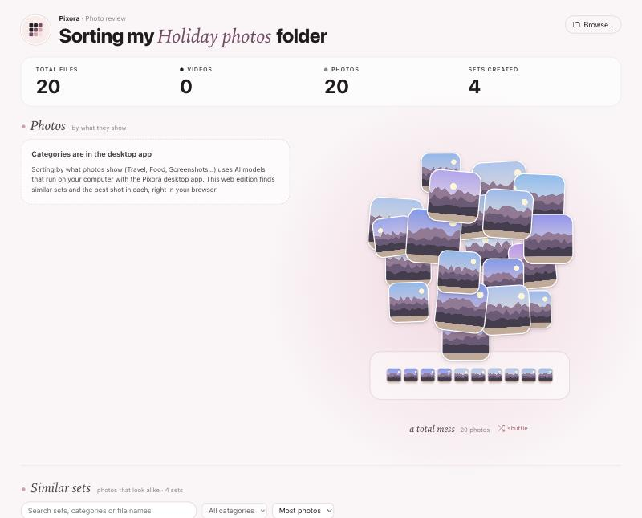

# Pixora

*Your photos, beautifully sorted.*

Pixora finds sets of similar photos (bursts, near-duplicates), suggests the best shot in each,
and lets you clean up the rest. You review every change before anything happens on disk. The
desktop app can also sort photos by what they show (Travel & Vibes, Food & Cafés,
Screenshots…) with AI models that run on your own computer.

**▶ Try the web edition: https://megaee.github.io/pixora/**: no install, and your photos never leave your computer.



*Screenshot of the web edition with generated sample images.*

## Two editions

| | Web edition | Desktop app |
|---|---|---|
| Install | none, open the link | Python 3.10+ and Node.js 20+ (see below) |
| Similar sets, best shot, review | ✓ | ✓ |
| Delete (recoverable), lossless rotate, undo | Chrome / Edge ✓, other browsers review only | ✓ (macOS Trash) |
| Shrink photos | – | ✓ |
| Content categories, AI mode | – | ✓ with the optional AI add-on |
| Where photos are processed | in your browser tab | on your computer |

## Features

- **Similar sets**: groups near-identical photos with a rotation-proof perceptual hash, even when
  a copy is stored sideways. Open a set, remove a photo, split or merge sets, search, filter and
  sort. Your edits are saved.
- **Best shot**: picks the sharpest, best-exposed photo in each set (★); in AI mode, an image
  quality model picks it instead.
- **Review before anything changes**: mark photos to keep, delete, rotate or shrink, see the full
  list, then confirm. **Undo last apply** reverses deletions and rotations.
- **Content categories** (desktop, AI add-on): 15 categories, scored with CLIP. Each photo gets a
  confidence score, a main category and extra labels. Unsure photos go to *Other /
  Unclassified* instead of getting a guess. You can correct any photo's category.
- **Statistics**: total files, videos (counted, never changed), photos and sets.

## Privacy and file access

- **Nothing is uploaded.** The web edition is a static site; images are decoded in your browser,
  and its Content-Security-Policy stops the page from sending data to any other server. The
  desktop app runs on `127.0.0.1` only.
- **You choose the folder.** A website cannot read your files on its own. You pick a folder, and
  only that folder's own files are read (not sub-folders).
- **Changes need your permission.** The web edition opens folders read-only and asks for write
  access when you press *Apply* or *Undo* (Chrome and Edge show their own permission prompt).
  Browsers cannot use the system Trash, so "delete" copies the photo into a `_to_delete`
  sub-folder, checks the copy, and only then removes the original. Rotation only changes the
  EXIF orientation tag (lossless). Every change is logged to `photo_cleanup_log.csv` in the folder.
- The desktop app moves deleted photos to the macOS Trash (`_to_delete/` on other systems) and
  keeps its own data (category corrections, set edits, cached analysis) in `~/.pixora`.

## Supported browsers (web edition)

| Browser | Expected support | Tested so far |
|---|---|---|
| Chrome, Edge (desktop) | full: review and apply changes (File System Access API) | Chromium: scanning, apply, undo |
| Firefox, Safari (desktop) | review only (folder upload, no write access) | not yet tested by hand |
| Mobile browsers | not supported: no folder access | – |

Needs Web Workers, `OffscreenCanvas` and `createImageBitmap`. JPEG, PNG, WebP, BMP and AVIF
work; HEIC and TIFF only where the browser can decode them, and are listed as skipped otherwise.

## Desktop app

Requirements: **Python 3.10+** (macOS ships 3.9: `brew install python@3.12`) and **Node.js 20+**.

```bash
git clone https://github.com/megaee/pixora.git
cd pixora
make setup                          # venv + dependencies (use PY=python3.12 if needed)
make start FOLDER=~/Pictures/trip   # builds the UI and opens http://127.0.0.1:8000
```

Optional AI add-on (content categories, AI mode; ~1 GB of packages, ~700 MB of models on first
use, cached in `~/.cache/huggingface`):

```bash
make setup-ai
```

Then click **Sort into categories** in the app. iPhone HEIC photos:
`backend/.venv/bin/pip install -e "backend[heic]"`.

**How categories work.** CLIP compares each photo with a few written descriptions per category
(`backend/src/photo_cleanup/categories.py`) and with a hidden "nothing in particular" class. A
category becomes the main one at ≥ 35 % with an 8-point lead over the next; others at ≥ 15 %
are extra labels. This is zero-shot CLIP ViT-B/32: reliable for clear subjects (scenery, food,
screenshots, receipts, chats in our tests) and weaker for close ones (Outfits vs Selfies,
Friends vs Events). It was checked on real photos and generated test images, not on a large
labelled dataset.

## Technology

React 19 + TypeScript + Vite (UI, shared by both editions) · Web Workers, OffscreenCanvas and the
File System Access API (web edition) · FastAPI + Pillow (desktop backend) · PyTorch +
Transformers with DINOv2-small and CLIP ViT-B/32 (optional AI add-on) · GitHub Actions + Pages.

## Development

```bash
make dev       # desktop: API on :8000 with reload + UI on http://localhost:5173
make dev-web   # web edition with hot reload, no Python needed
make test      # pytest (backend) + vitest (frontend)
make test-ai   # also the real AI models (needs make setup-ai)
make lint      # ruff, eslint, tsc, prettier
make check     # everything CI runs, incl. both builds
make build-web # web edition into frontend/dist
```

Project structure and coding rules for contributors (and Claude Code) are in
[CLAUDE.md](CLAUDE.md).

## Deployment and releases

- **Web edition**: every push to `main` runs lint and tests, builds `frontend/dist` and deploys it
  to GitHub Pages (`.github/workflows/pages.yml`). Rollback: revert the commit and push, or
  re-run an earlier *Deploy* workflow run.
- **Releases**: update the version in `frontend/package.json`, `backend/pyproject.toml` and
  `backend/src/photo_cleanup/__init__.py`, add a section to [CHANGELOG.md](CHANGELOG.md), commit,
  then tag and push:

  ```bash
  git tag v1.0.0 && git push origin v1.0.0
  ```

  `.github/workflows/release.yml` checks that the tag matches the version, builds the web edition,
  and publishes a GitHub Release with the CHANGELOG notes and `pixora-web-<tag>.zip`. A tag with
  a suffix (like `-beta.1`) becomes a pre-release.

## Release history

See [CHANGELOG.md](CHANGELOG.md) and [Releases](https://github.com/megaee/pixora/releases).

## Contributing

Issues and pull requests are welcome. Please run `make check` before opening a PR. The rule that
matters most: nothing may change a user's files without their explicit confirmation.

## License

[MIT](LICENSE) © 2026 Meganathan
